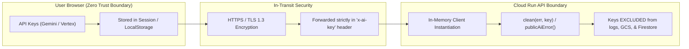

# TruthLens — GCP Architecture Diagram

This document illustrates the Google Cloud Platform (GCP) services, network topology, container deployment, data storage, and external AI integrations that power the **TruthLens** multimodal verification platform.

---

## High-Level Cloud Architecture

```mermaid
flowchart TB
    subgraph CLIENT["Client Tier (User Browser)"]
        UI["React 18 + Vite SPA"]
        BYOK["Client BYOK Storage (LocalStorage / SessionStorage)"]
        PLAYER["HTML5 Video Player (Byte-Range Streaming)"]
    end

    subgraph GCP["Google Cloud Platform (GCP) Project"]
        subgraph IAM["Security & Identity"]
            SA["Cloud Run Service Account"]
            ROLES["IAM Roles (roles/datastore.user, roles/storage.objectAdmin)"]
        end

        subgraph INGRESS["Container Hosting & API Tier"]
            CR["Google Cloud Run (truthlens service)"]
            FLAGS["Config: --no-cpu-throttling, memory 1Gi, cpu 1"]
            EXPRESS["Express.js API Server (Port 8080)"]
            STATIC["Static Assets Handler (/public dist bundle)"]
            LIMITER["Daily Rate Limiter & Concurrency Semaphore"]
        end

        subgraph STORAGE["Persistence & State Tier"]
            GCS[("Google Cloud Storage (GCS Bucket)")]
            GCS_UPLOADS["gs://bucket/uploads/{sha256}"]
            GCS_AUDIO["gs://bucket/audio/{sha256}"]
            
            FIRESTORE[("Cloud Firestore (Native Mode)")]
            FS_POSTS["Collection: posts/{id}"]
            FS_EXTRACTIONS["Collection: extractions/{sourceId}"]
            FS_REPORTS["Collection: reports/{id}"]
            FS_LIMITS["Collection: upload_limits/{ip_date}"]
        end

        subgraph AI_SERVICES["Google AI Services"]
            GEMINI["Gemini 3.8 / 3.5 Flash (Multimodal Vision & Audio)"]
            VERTEX["Vertex AI Model Garden (Enterprise Endpoint)"]
            SEARCH["Google Search Grounding Tool (Real-time Live Web)"]
        end

        subgraph BUILD["CI/CD & Image Registry"]
            CB["Google Cloud Build"]
            AR["Artifact Registry / Container Registry"]
        end
    end

    subgraph EXTERNAL["External Sources & Grounding"]
        YOUTUBE["YouTube Video CDN (Public Embeds & Shorts)"]
        NEWS_SOURCES["Authoritative Web & News Articles"]
    end

    %% Client Interactions
    UI -->|"HTTPS Requests (API & Assets)"| CR
    BYOK -.->"x-ai-key & x-ai-provider (Header Only)"| CR
    PLAYER <-->|"HTTP 206 Partial Content (Streaming)"| EXPRESS

    %% Ingress & Host
    CR --- FLAGS
    CR --> STATIC
    CR --> EXPRESS
    EXPRESS --> LIMITER
    SA --> ROLES
    ROLES -.-> CR

    %% Storage Connections
    EXPRESS -->|"Save Raw Media & Stream Proxy"| GCS
    GCS --- GCS_UPLOADS
    GCS --- GCS_AUDIO
    
    EXPRESS <-->|"Cache Lookup & Report Persistence"| FIRESTORE
    FIRESTORE --- FS_POSTS
    FIRESTORE --- FS_EXTRACTIONS
    FIRESTORE --- FS_REPORTS
    FIRESTORE --- FS_LIMITS

    %% AI Connections
    EXPRESS -->|"Multimodal Extraction (Speech, OCR, Deepfake)"| GEMINI
    EXPRESS -.->"Optional Enterprise Gen AI"| VERTEX
    GEMINI <-->|"Live Fact Grounding"| SEARCH
    SEARCH <-->|"Retrieve Reference Articles"| NEWS_SOURCES

    %% External Inputs
    EXPRESS -.->"Canonical URL Extraction"| YOUTUBE
    EXPRESS -.->"Web Article Scraper"| NEWS_SOURCES

    %% Build flow
    CB -->|"Deploy Container Image"| AR
    AR -->|"Deploy"| CR
```

---

## GCP Service Responsibilities

| GCP Component | Service Type | Operational Role & Configuration |
|---|---|---|
| **Google Cloud Run** | Serverless Compute | Hosts the unified multi-stage container running Express and serving Vite static assets. Configured with `--no-cpu-throttling` so asynchronous multimodal background jobs continue uninterrupted after HTTP 200/202 responses. |
| **Google Cloud Storage (GCS)** | Object Storage | Private storage bucket (`gs://[PROJECT_ID]-truthlens-videos`) containing raw video and audio uploads keyed deterministically by their SHA-256 checksums (`uploads/{sha256}`, `audio/{sha256}`). |
| **Google Cloud Firestore** | NoSQL Document DB | Stores post metadata (`posts`), cached multimodal extractions (`extractions`), finalized investigation dossiers (`reports`), and IP rate limiting counters (`upload_limits`). Configured with `ignoreUndefinedProperties: true`. |
| **Google GenAI / Vertex AI** | Foundation Models | Gemini 3.8 Flash & Gemini 3.5 Flash process video, audio, and article payloads for transcription, chyron OCR, synthetic speech cadence, facial artifacts, and claim extraction. |
| **Google Search Grounding** | Live Grounding | Directly connected to the Gemini model calls via `tools: [{ googleSearch: {} }]` to corroborate isolated claims against current authoritative news sources. |
| **Cloud Build & Artifact Registry** | DevOps Pipeline | Automated by `deploy.sh` to compile frontend assets, construct the container image, and deploy to Cloud Run. |
| **IAM & Service Accounts** | Identity & Security | Cloud Run runtime service account scoped strictly to `roles/datastore.user` and `roles/storage.objectAdmin`. |

---

## Security & Isolation Perimeter



- **Client Isolation**: User-supplied keys are sent on request headers (`x-ai-key`) and consumed ephemerally per request.
- **Redaction**: All exceptions and downstream error messages pass through `publicAiError` to guarantee raw credentials or internal tokens never leak into client responses or Cloud Logging.
