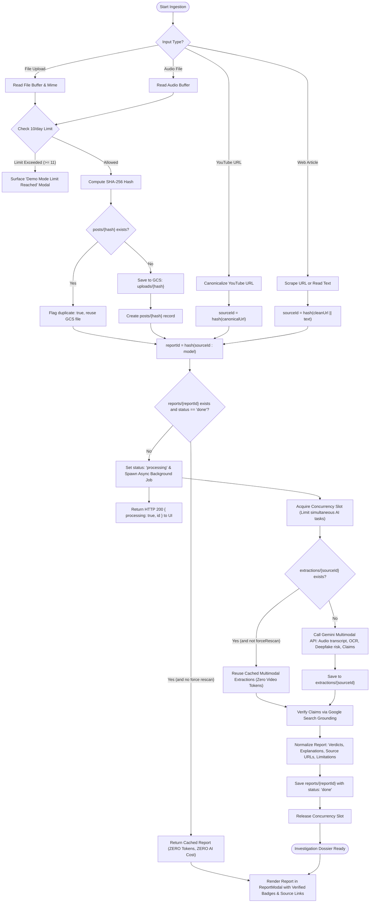

# TruthLens — End-to-End Process Flow Diagram

This document illustrates the end-to-end process and lifecycle workflows in **TruthLens**, from media ingestion and deduplication through two-tier multimodal extraction, Google Search grounding, report normalization, and zero-cost retrieval.

---

## Complete Multimodal Verification Lifecycle

```mermaid
sequenceDiagram
    autonumber
    actor User as User / Investigator
    participant UI as Frontend (React + Vite)
    participant API as Backend (Cloud Run Express)
    participant RateLimit as Rate Limiter (Firestore)
    participant GCS as Cloud Storage (GCS)
    participant DB as Cloud Firestore
    participant Gemini as Gemini AI (Multimodal)
    participant Search as Google Search Grounding

    %% ----------------------------------------------------
    %% Step 1: Ingestion & Deduplication
    %% ----------------------------------------------------
    rect rgb(240, 248, 255)
    note over User, GCS: Phase 1: Ingestion, Validation & Deduplication
    User->>UI: Selects Video Upload / YouTube Link / Web Article / Audio
    UI->>API: POST /api/upload OR /api/analyse/*

    API->>RateLimit: Check daily limit (10 uploads/day for IP)
    alt Daily Quota Exceeded (11th Try)
        RateLimit-->>API: Limit exceeded (allowed: false)
        API-->>UI: HTTP 429 { limitReached: true }
        UI-->>User: Display "Demo Mode Limit Reached" Dialog
    else Limit Within Bound
        RateLimit-->>API: Allowed (allowed: true)
    end

    alt Direct File Upload
        API->>API: Compute SHA-256 Checksum Hash(Buffer)
        API->>DB: Check if posts/{sha256} exists
        alt Duplicate Media File Found
            DB-->>API: Return existing post record
            API-->>UI: HTTP 200 { duplicate: true, postId }
        else New Media File
            API->>GCS: Save raw file to uploads/{sha256}
            API->>DB: Create posts/{sha256} metadata record
            API-->>UI: HTTP 200 { post: {...}, videoUrl: /api/video/{id} }
        end
    else YouTube URL Ingestion
        API->>API: Canonicalize URL to https://www.youtube.com/watch?v={id}
        API->>API: Compute deterministic sourceId = hash(canonicalUrl)
    else Web Article Ingestion
        opt URL Provided (Scrape required)
            API->>API: Fetch HTML & Extract Clean Article Text
        end
        API->>API: Compute deterministic sourceId = hash(url || text)
    end
    end

    %% ----------------------------------------------------
    %% Step 2: Caching & Zero-Cost Check
    %% ----------------------------------------------------
    rect rgb(245, 255, 245)
    note over UI, DB: Phase 2: Zero-Cost Historical Gate
    UI->>API: POST /api/analyse (postId | url)
    API->>API: Compute reportId = hash(sourceId : model)
    API->>DB: Fetch reports/{reportId}

    alt Existing Valid Report Cached & No Force Rescan
        DB-->>API: Cached report with status: done
        API-->>UI: HTTP 200 { cached: true, report: {...} }
        UI-->>User: Instant Dossier Display (0 AI Tokens & 0 Cost)
    else Report Pending or New Analysis Required
        API->>DB: Set reports/{reportId} status: processing
        API-->>UI: HTTP 200 { cached: false, processing: true, id: reportId }
        UI-->>User: Show "Analyzing Evidence..." Spinner & Timer
    end
    end

    %% ----------------------------------------------------
    %% Step 3: Multimodal Extraction Pipeline
    %% ----------------------------------------------------
    rect rgb(255, 250, 240)
    note over API, Gemini: Phase 3: Multimodal Extraction & Forensic Evaluation
    API->>API: Acquire Execution Slot (Concurrency Semaphore)
    
    API->>DB: Check extractions/{sourceId}
    alt Cached Extraction Available & Not Force Rescan
        DB-->>API: Cached speech transcript, OCR, and claims
        note over API: Skip heavy video ingestion (Saves 100k+ input tokens)
    else Run Fresh Extraction
        alt Video / YouTube Payload
            API->>Gemini: Stream video frames + audio track
            note over Gemini: 1. Transcribe speech<br/>2. OCR on-screen text & chyrons<br/>3. Forensics: lip-sync, splicing, deepfake<br/>4. Extract up to 5 checkable factual claims
            Gemini-->>API: Return Structured Extraction JSON
        else Article Payload
            API->>Gemini: Send full article text & metadata
            note over Gemini: 1. Stylometry & AI authorship analysis<br/>2. Sensationalism & clickbait scoring<br/>3. Quote attribution verification<br/>4. Extract checkable factual claims
            Gemini-->>API: Return Structured Article Extraction JSON
        end
        API->>DB: Persist intermediate result in extractions/{sourceId}
    end
    end

    %% ----------------------------------------------------
    %% Step 4: Grounded Fact-Checking
    %% ----------------------------------------------------
    rect rgb(255, 245, 250)
    note over API, Search: Phase 4: Google Search Grounding & Claim Corroboration
    API->>Gemini: Send extracted claims + Google Search Tool { googleSearch: {} }
    Gemini->>Search: Query live web & authoritative news sources
    Search-->>Gemini: Retrieve live source snippets and URLs
    Gemini-->>API: Return Verdicts (Verified, Contradicted, Misleading, Inconclusive), explanations & source citations
    end

    %% ----------------------------------------------------
    %% Step 5: Report Normalization & Persistence
    %% ----------------------------------------------------
    rect rgb(248, 248, 255)
    note over API, DB: Phase 5: Normalization & Storage
    API->>API: Assemble final report schema:
    note over API: - Verdict & Confidence Score<br/>- Synthetic media risk assessment<br/>- Verified claims with origin tags (Spoken / OCR / Text)<br/>- Sources consulted list<br/>- Persistent original source link (YouTube/Article URL)
    API->>DB: Save reports/{reportId} (status: done)
    API->>API: Release Concurrency Slot
    end

    %% ----------------------------------------------------
    %% Step 6: Client Display
    %% ----------------------------------------------------
    rect rgb(255, 255, 255)
    note over User, UI: Phase 6: Interactive Investigation Dossier
    UI->>API: GET /api/reports/{reportId} (Polling or User Click)
    API-->>UI: HTTP 200 { report: {...} }
    UI->>UI: Extract keyframe captures from video stream
    UI-->>User: Render ReportModal with:
    note over UI: - Claims breakdown & verdict badges<br/>- Synthetic media risk gauge & reasoning<br/>- Keyframe image gallery<br/>- Sources Consulted list<br/>- Original YouTube / Article Source Link (with copy & external open)
    end
```

---

## Detailed Logic Flow: Decision Tree

---

## Two-Tier Caching & Token Economics

```mermaid
flowchart LR
    subgraph TIER1["Tier 1: Multimodal Extraction (Heavyweight)"]
        direction TB
        V_IN["Raw Video Stream / 120s Audio"]
        V_GEN["Gemini Multimodal Processing"]
        V_OUT["Transcription + OCR + Deepfake Risk + 5 Claims"]
        V_CACHE[("extractions/{sourceId}")]
        V_IN --> V_GEN --> V_OUT --> V_CACHE
    end

    subgraph TIER2["Tier 2: Fact Grounding (Lightweight)"]
        direction TB
        CLAIMS["Extracted Claims (Text Only)"]
        G_SEARCH["Google Search Tool"]
        G_VERIFY["Fact-Check Verdicts & Citations"]
        V_OUT -.-> CLAIMS
        V_CACHE -.->|"Refresh Fact-Check"| CLAIMS
        CLAIMS --> G_SEARCH --> G_VERIFY
    end

    subgraph REPORT["Final Investigation Dossier"]
        REP_DB[("reports/{id}")]
        ZERO_COST["Zero-Cost Browsing (0 Tokens)"]
        G_VERIFY --> REP_DB
        REP_DB --> ZERO_COST
    end
```

- **Tier 1 (Video Extraction)** consumes between 50,000 and 150,000 multimodal tokens and executes only once per unique video file or YouTube URL.
- **Tier 2 (Search Grounding)** consumes only 500 to 1,500 text tokens to search the live web and verify claims.
- Clicking **"Refresh Fact-Check"** in the dossier report executes Tier 2 directly from the cached Tier 1 extraction, resulting in a **99% token savings** and enabling rapid re-verification against breaking news without reprocessing video.
