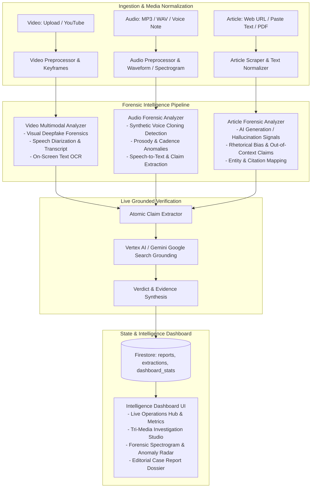

# Implementation Plan: TruthLens Multimodal Intelligence Dashboard
*Forensic Analysis & Verification Platform for Articles, Audio, and Video*

## Executive Summary & Product Vision
In modern digital media, newsrooms, fact-checkers, educational institutions, and trust & safety desks face a continuous deluge of synthetic and manipulated media. Adversarial misinformation is no longer confined to isolated text claims—it spans:
1. **Synthetic Voice Clones & Audio Leaks**: Fabricated phone calls, cloned executive statements, and manipulated podcast snippets.
2. **Generative & Manipulated Video**: Diffusion-generated clips (Sora/Runway/Pika), deepfake face swaps, lip-sync manipulation, and context-omitted temporal splices.
3. **Deceptive Articles & Synthesized Text**: Automated generative news farms, hallucinated citations, distorted context, and biased narrative spin.

**TruthLens Intelligence Dashboard** transforms the current video-focused application into an **enterprise-grade, cross-modal intelligence workbench** running on Google Cloud (Vertex AI, Firestore, GCS, Gemini 3.8/2.5 Flash), offering unified forensic ingestion, analysis, and case management across **Articles**, **Audios**, and **Videos**.

---

## Architecture Topology: Unified Tri-Media Forensic Engine



---

## Product Requirements & Real-World Newsroom Challenges

### 1. Unified Intelligence Hub (Command Center)
- **Problem**: Editors and fact-checkers have no single pane of glass to view verified vs. debunked stories across multiple formats.
- **Requirement**:
  - Top-level overview cards: **Total Submissions**, **Synthetic Media Flagged (%)**, **Verified / Contradicted Breakdown**, **Average Turnaround Time**.
  - Unified Investigation Feed filterable by format (`All`, `Video`, `Audio`, `Article`) and risk level (`Critical`, `High`, `Moderate`, `Low`).
  - Search & filter by source, domain, creator, or keyword.

### 2. Video Forensic Lab
- **Real-World Challenges**: Diffusion artifacts, face swaps, lip-sync desync, on-screen chyrons misleading viewers while audio says something else.
- **Requirement**:
  - Tri-track analysis (Audial, Visual, OCR text).
  - Video scrubber synced with keyframe thumbnails and detected claim pins.
  - Deepfake Risk Meter with categorized anomaly signals (e.g. unnatural blinking, boundary warps).

### 3. Audio Forensic Lab
- **Real-World Challenges**: Cloned voices of public figures circulating on WhatsApp/Telegram; lack of visual context makes synthetic speech hard to verify by ear alone.
- **Requirement**:
  - Ingest MP3, WAV, M4A, or audio URLs.
  - Interactive audio waveform player with timestamp seeking.
  - Voice Synthesis & Deepfake Analysis: Detect robotic frequency artifacts, unnatural cadence, breathing inconsistencies, and speech synthesis markers.
  - Verbatim transcript generation with atomic claim extraction and search grounding.

### 4. Article & Text Forensic Lab
- **Real-World Challenges**: SEO-optimized synthetic news sites fabricating quotes; articles taking a real quote out of context; hallucinated academic sources.
- **Requirement**:
  - Ingest via direct URL (auto-scrape headline, author, body) or raw text paste.
  - AI-Generated Content Analysis (stylometric consistency, repetition, perplexity patterns).
  - Citation & Quote Grounding: Identifies quotes and cross-references them against official registries or primary transcripts.
  - Headline vs. Body sensationalism / clickbait distortion index.

### 5. Newsroom Editorial Dossier (Export & Reporting)
- **Requirement**:
  - Structured export (JSON / printable audit format) detailing all checked claims, verified sources, forensic anomalies, and suggested editorial actions (e.g., "Add Community Note", "Flag as Manipulated Media", "Publish Correction").

---

## Proposed System Architecture & API Contracts

### Extended API Routes (`backend/server.js`)

1. **`POST /api/analyse/video`** (Enhanced video forensic pipeline):
   - Supports `postId`, `url`, `forceRescan`, `refreshFactCheckOnly`.
2. **`POST /api/analyse/audio`** (New Audio forensic endpoint):
   - Accepts audio upload (MP3/WAV/M4A) or audio URL.
   - Performs voice synthesis detection, audio prosody check, transcription, and search grounding.
3. **`POST /api/analyse/article`** (New Article forensic endpoint):
   - Accepts article URL or raw text paste.
   - Extracts title, author, body, analyzes AI authorship likelihood, sensationalism, extracts claims, and grounds them against authoritative sources.
4. **`GET /api/dashboard/stats`** (Dashboard metrics):
   - Returns aggregated statistics: total investigated, breakdown by media type (`video`, `audio`, `article`), verdict distribution, synthetic risk distribution.
5. **`POST /api/upload/audio`** (Audio file ingestion):
   - Supports MP3, WAV, M4A, AAC up to 30MB with SHA-256 deduplication.

---

## Enhanced Forensic Data Model (Firestore)

```typescript
export type MediaType = 'video' | 'audio' | 'article';

export interface ForensicReport {
  id: string;
  mediaType: MediaType;
  sourceId: string;
  status: 'processing' | 'done' | 'error';
  updatedAt: number;
  model: string;
  pipelineVersion: string;

  // Metadata
  metadata: {
    title: string;
    creator?: string;
    url?: string;
    postId?: string;
    duration?: number; // for audio/video
    wordCount?: number; // for articles
  };

  // Overall Assessment
  verdict: 'Supported' | 'Contradicted' | 'Misleading' | 'Mixed' | 'Insufficient Evidence';
  confidence: number; // 0-100
  explanation: string;

  // Format-Specific Forensic Breakdown
  forensics: {
    syntheticRisk: 'low' | 'moderate' | 'high' | 'critical';
    confidence: number;
    reasoning: string;
    anomalies: string[];
    // Audio specific
    voiceCloningSignals?: {
      cadenceScore: number;
      prosodyAnomalyDetected: boolean;
      syntheticBreathingPattern: boolean;
    };
    // Article specific
    textAuthenticity?: {
      aiProbability: number; // 0-100
      sensationalismScore: number; // 0-100
      citationIntegrity: 'verified' | 'unsupported_citations' | 'hallucinated_sources';
    };
  };

  // Multimodal Content Extractions
  content: {
    transcript?: string; // audio/video
    ocrText?: Array<{timestamp: string; text: string}>; // video
    articleBody?: string; // article
    quotesAnalyzed?: Array<{quote: string; speaker: string; verifiedContext: string}>;
  };

  // Grounded Fact-Checking
  claims: Array<{
    text: string;
    origin: 'speech' | 'on_screen_text' | 'article_text';
    timestamp?: string;
    category: string;
    verdict: 'Supported' | 'Contradicted' | 'Misleading' | 'Mixed' | 'Insufficient Evidence';
    explanation: string;
  }>;

  // Sources & Recommendations
  sources: Array<{uri: string; title: string}>;
  misleading: string[];
  nextSteps: string[];
  limitations: string;
}
```

---

## UI / UX Design & Components

### 1. Navigation & App Shell
- **Top Command Bar**:
  - Live Status indicator ("System Operational - Gemini 3.8 Flash Active").
  - Quick Search input across all intelligence records.
  - AI Configuration settings modal.
- **Main View Tabs**:
  - **Overview (Command Hub)**: Real-time metrics, recent alerts, synthetic risk radar.
  - **Video Studio**: Phone feed player, URL analyzer, drag-and-drop video upload.
  - **Audio Studio**: Audio waveform player, voice note/podcast upload, synthetic voice detector.
  - **Article Studio**: Article URL fetcher, text inspector, quote & hallucination verifier.
  - **Investigations Log**: Searchable, filterable audit log of all completed investigations.

### 2. High-Impact Visual Elements
- **Synthetic Risk Gauge**: Vibrant, distinct risk pill indicators with pulse animations for critical deepfakes.
- **Waveform / Scrubber Component**: Interactive playback seeking for audio and video files.
- **Claim Origin Tags**: Clean badges marking claim origin (`Spoken`, `On-Screen`, `Article Text`).
- **Glassmorphic Cards**: Deep subtle shadows, rich contrast, and sleek typography from SF Pro / Inter.

---

## Verification & Validation Plan

### Automated Verification
```bash
# 1. Backend API Syntax & Routes Verification
node --check backend/server.js

# 2. Frontend Strict TypeScript & Vite Bundle Build
npm run build --prefix frontend
```

### Manual Verification Scenarios
1. **Video Ingestion & Verification**:
   - Ingest MP4/WebM video, verify transcript, OCR, deepfake risk badge, and grounded claim verification.
2. **Audio Forensic Testing**:
   - Ingest audio clip (speech/voice note), verify waveform playback, voice cloning heuristics, and fact-checking.
3. **Article Forensic Testing**:
   - Paste article text / URL, verify AI authorship score, claim extraction, and source citations.
4. **Dashboard Aggregation**:
   - Check Overview tab for accurate real-time counts across all media types.
5. **Report & Re-run Separation**:
   - Ensure opening historical items is zero-cost, and re-running functions accurately.
